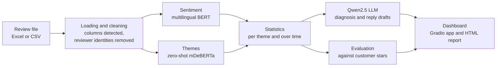

# ReviewPulse

**Turn hundreds of customer reviews into clear actions.**

[](https://colab.research.google.com/github/Monka31/reviewpulse/blob/main/ReviewPulse.ipynb)

Live reports: https://monka31.github.io/reviewpulse/

ReviewPulse reads every Google review of a business and gives its owner, in a couple of minutes, a dashboard that answers four questions. What do customers like? What do they complain about, and is it getting better or worse? Which complaints were never answered? What should the owner reply to each of them?

The application runs in Google Colab on a free GPU, with three open-source models downloaded from Hugging Face. It needs no paid API and no API key.

## The problem

A restaurant, a shop, a hotel or a school can collect several hundred reviews, and new ones arrive every week. Owners rarely have time to read them, so they look at the star average and move on. Recurring problems go unnoticed, and complaints stay unanswered even though every future customer can read them on Google Maps.

The ESSEC Cergy campus, one of our two demo cases, shows how misleading the average can be. Its public rating is 4.28 out of 5 over 250 ratings. When we keep only the 76 people who wrote a text, the average drops to 3.66, and 22 of those 76 written reviews give a single star. The file contains no reply from the school to any of them. The yearly trend also dipped in 2023 (3.9 out of 5, with 28% of ratings at one or two stars) before recovering in 2026.

## What the application does

The user drops an Outscraper export (Excel or CSV) of a business's Google reviews, picks the type of business and clicks Analyze reviews. ReviewPulse then detects the sentiment of every written review, assigns each review to one or several themes adapted to the business (food quality and waiting time for a restaurant, admissions and campus for a school), and computes statistics per theme and over time.

A language model writes a short diagnosis with strengths, points to improve and three priority actions, and drafts a public reply for each unanswered complaint, in the language of the review. Customers' own star ratings are then used to measure how often the AI reads a review correctly.

Everything is shown on one dashboard: the main figures, the AI diagnosis, five charts (sentiment, share of themes, rating over time, a priority matrix showing which themes to fix first, and average stars by theme), the list of unanswered complaints with their reply drafts, and a table of every review. Filters by period, stars and theme update the whole dashboard instantly, without running the models again. The same dashboard can be exported as a static web page and published on GitHub Pages, which gives each analysis a permanent link.

## Value if widely used

Large chains pay customer-experience platforms and consultants for this kind of analysis. Independent businesses, which make up most of the restaurants, shops and hotels people review, usually do it by hand or not at all. ReviewPulse gives them the same reading of their reviews for free, in minutes, with open models they can run themselves. Used widely, it would save owners the hours spent reading reviews, point them to the problems customers mention most, and help them answer unhappy customers while the answer can still change their mind. Customers would benefit too, through faster fixes and businesses that visibly respond.

## Quick start

Open the notebook with the Open in Colab button, choose `Runtime > Change runtime type > T4 GPU`, then `Runtime > Run all`. After three to five minutes the last cell prints a `gradio.live` link: that is the application. Drop a review file in it, or use the ESSEC dataset already in the project.

The [user guide](documentation/USER_GUIDE.md) explains every screen, the local installation and how to collect reviews for any business. Section 8 of the notebook also generates the narrated demo video automatically, from the same analysis.

## How it works



Sentiment comes from `nlptown/bert-base-multilingual-uncased-sentiment`, a BERT model fine-tuned on product reviews in six languages, French and English included, which predicts a rating from one to five stars. Themes come from `MoritzLaurer/mDeBERTa-v3-base-mnli-xnli`, a multilingual natural language inference model used for zero-shot classification, so a business can define its own themes without labeling a single example. Text generation uses `Qwen/Qwen2.5-3B-Instruct` on a GPU and the smaller `Qwen2.5-0.5B-Instruct` on a CPU. The [technical report](documentation/TECHNICAL_REPORT.md) explains each choice, the prompts and the evaluation method.

## How the project answers the assignment

The application is built from existing tools, as the assignment asks: pre-trained models from Hugging Face, code and hosting on GitHub (repository, Colab link and GitHub Pages), and the Python ecosystem around them. It goes beyond the course content by chaining three transformer models (classification, zero-shot inference and generation) in one pipeline and by evaluating them against real labels. It addresses a specific need, the unread and unanswered reviews of small businesses, and it can be re-run by anyone in one click from the Colab notebook, on the data stored in this repository. The [prompts log](documentation/prompts_log.md) reports where and how AI assistants were used, with the prompts. The data sources are described in [DATA.md](documentation/DATA.md).

The project applies several concepts from the course. The sentiment model is supervised learning and transfer learning: a model trained on millions of reviews is reused without retraining. The theme detector shows zero-shot learning through natural language inference. The diagnosis and replies use generative AI with prompt engineering and grounding, since the model receives computed statistics and real excerpts instead of being asked to read everything. The evaluation uses accuracy against a majority-class baseline, precision, recall and a confusion matrix. Finally, the design keeps a human in the loop (replies are drafts) and removes reviewers' personal data on load.

## Repository

```
reviewpulse/
├── ReviewPulse.ipynb          one-click Colab notebook (analysis and app)
├── app.py                     Gradio web application
├── requirements.txt           Python dependencies
├── reviewpulse/               analysis package
│   ├── config.py              models, theme presets and settings
│   ├── data.py                file loading, column detection, anonymization
│   ├── models.py              Hugging Face models (and a mock backend for tests)
│   ├── analysis.py            sentiment, themes, statistics
│   ├── llm.py                 every prompt sent to the language model
│   ├── evaluation.py          accuracy against customer stars
│   ├── dashboard.py           HTML dashboard, charts and filters
│   ├── charts.py              interactive Plotly charts for the notebook
│   ├── report.py              static reports for GitHub Pages
│   └── demo_video.py          automated narrated demo video
├── scripts/
│   ├── analyze.py                     command line: review file to report
│   ├── make_demo_video.py             command line: build the demo video
│   └── collect_reviews_outscraper.py  review collection and anonymization
├── data/                      anonymized review datasets
├── docs/                      GitHub Pages site with the published reports
├── documentation/             user guide, technical report, data, prompts, video script
└── tests/                     automated tests (no model download needed)
```

## Limitations

The sentiment model sometimes misreads irony and mixed reviews, especially at three stars. The evaluation section of each analysis shows its measured accuracy on that business. Zero-shot themes depend on how the themes are worded, and vague themes give noisy results. The language model can be generic or occasionally wrong, so every reply is a draft that a person must read before posting. Collecting Google Maps reviews with a third-party service may conflict with Google's terms of service; we used the data for analysis only, kept no reviewer identity, and the project should not be read as a commercial scraping service. Free Colab GPUs are not guaranteed, and on a CPU the generation steps are slow.

## Credits

Models: [nlptown/bert-base-multilingual-uncased-sentiment](https://huggingface.co/nlptown/bert-base-multilingual-uncased-sentiment), [MoritzLaurer/mDeBERTa-v3-base-mnli-xnli](https://huggingface.co/MoritzLaurer/mDeBERTa-v3-base-mnli-xnli), [Qwen/Qwen2.5-3B-Instruct](https://huggingface.co/Qwen/Qwen2.5-3B-Instruct) and [Qwen/Qwen2.5-0.5B-Instruct](https://huggingface.co/Qwen/Qwen2.5-0.5B-Instruct).

Packages: [Transformers](https://github.com/huggingface/transformers), [Accelerate](https://github.com/huggingface/accelerate), [PyTorch](https://pytorch.org/), [Gradio](https://github.com/gradio-app/gradio), [pandas](https://pandas.pydata.org/), [Plotly](https://plotly.com/python/), [Python-Markdown](https://python-markdown.github.io/), [openpyxl](https://openpyxl.readthedocs.io/), [SentencePiece](https://github.com/google/sentencepiece) and [pytest](https://pytest.org/). Fonts: Inter and Plus Jakarta Sans from Google Fonts.

Data: Google Maps reviews collected with [Outscraper](https://outscraper.com/), see [DATA.md](documentation/DATA.md).

Team: [names of the team members]. Course: Advanced AI Algorithms, ESSEC Business School, Advanced Master in Marketing Management & Digital, 2026. License: MIT.
