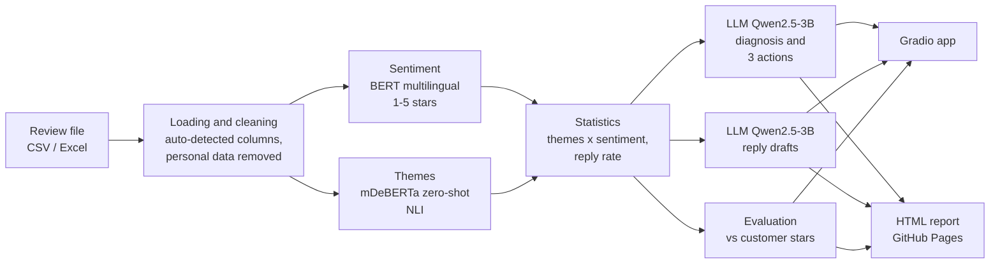

# ReviewPulse

**Turn hundreds of customer reviews into clear actions, in minutes.**

[](https://colab.research.google.com/github/Monka31/reviewpulse/blob/main/ReviewPulse.ipynb)
&nbsp;Live reports: https://monka31.github.io/reviewpulse/

ReviewPulse reads every online review of a business (restaurant, school, hotel, shop...) and tells the owner:

- what customers love and what frustrates them, theme by theme;
- which negative reviews were never answered, even though every future customer can read them;
- a written diagnosis with three priority actions;
- a ready-to-edit public reply for each unanswered complaint.

It runs for free in Google Colab, with open-source Hugging Face models only. No paid API, no API key.

## Why it matters

Small businesses receive more reviews than they can read. Most owners skim the star average, miss recurring problems, and leave complaints unanswered. Yet reviews drive most local buying decisions, and an unanswered complaint stays public forever.

If ReviewPulse were used widely, millions of independent businesses could get the kind of customer-insight analysis that today only large chains pay consultants or SaaS platforms for: hours saved every week, faster fixes of the real problems, and more unhappy customers won back through a timely, personal reply.

## Quick start (5 minutes, no installation)

1. Click **Open in Colab** above.
2. `Runtime > Change runtime type > T4 GPU`.
3. `Runtime > Run all`.
4. Open the `gradio.live` link printed by the last cell.

Full instructions, local installation, how to use your own data and troubleshooting: **[documentation/USER_GUIDE.md](documentation/USER_GUIDE.md)**.

## How it works



| Step | What happens | Model / tool |
|---|---|---|
| 1. Load | Any CSV/Excel with a text column. Columns are matched automatically (Outscraper, Apify, Kaggle, hand-made). Reviewer names, IDs and photos are dropped. | pandas |
| 2. Sentiment | Each review gets predicted stars (1 to 5), mapped to negative / neutral / positive. Works in French and English. | [`nlptown/bert-base-multilingual-uncased-sentiment`](https://huggingface.co/nlptown/bert-base-multilingual-uncased-sentiment) |
| 3. Themes | Each review is tested against business-specific themes (e.g. food quality, waiting time) without any training, using natural language inference. | [`MoritzLaurer/mDeBERTa-v3-base-mnli-xnli`](https://huggingface.co/MoritzLaurer/mDeBERTa-v3-base-mnli-xnli) |
| 4. Insights | Sentiment per theme, net score, reply rate, unanswered negative reviews, monthly trend. | pandas, Plotly |
| 5. Generation | Written diagnosis with 3 priority actions, and a reply draft per unanswered complaint (in the review's language). | [`Qwen/Qwen2.5-3B-Instruct`](https://huggingface.co/Qwen/Qwen2.5-3B-Instruct) |
| 6. Evaluation | The AI's predicted stars are compared with the stars customers actually gave: accuracy, baseline, precision/recall, confusion matrix. | pandas |
| 7. Delivery | Interactive web app, plus a static HTML report published on GitHub Pages (permanent link). | Gradio, GitHub Pages |

## Concepts from "Introduction to AI for Business" applied

- **Transfer learning with pre-trained transformers**: no model is trained; we reuse models trained on millions of texts.
- **Zero-shot learning**: themes are detected without a single labeled example, so any business can define its own themes.
- **Generative AI and prompt engineering**: structured prompts with grounding data and explicit rules to limit hallucinations (see `reviewpulse/llm.py`).
- **Model evaluation**: accuracy against a majority-class baseline, precision and recall per class, confusion matrix, using customer stars as free labels.
- **Human in the loop**: replies are drafts that the owner reviews before posting.
- **Business value and responsible AI**: GDPR-minded data handling, documented limitations.

## Project structure

```
reviewpulse/
├── ReviewPulse.ipynb         one-click Colab notebook (analysis + app)
├── app.py                    Gradio web app
├── reviewpulse/              analysis package
│   ├── config.py             models, theme presets, settings
│   ├── data.py               file loading, column detection, anonymization
│   ├── models.py             Hugging Face backend (+ mock backend for tests)
│   ├── analysis.py           sentiment, themes, statistics, insights
│   ├── llm.py                every LLM prompt used by the app
│   ├── evaluation.py         accuracy vs customer stars
│   ├── charts.py             Plotly charts
│   └── report.py             static HTML reports for GitHub Pages
├── scripts/
│   ├── analyze.py                    command line: file -> CSV + HTML report
│   └── collect_reviews_outscraper.py data collection (Outscraper API or export)
├── data/                     review datasets (anonymized)
├── docs/                     GitHub Pages site (published reports)
├── documentation/            user guide, AI prompts log, demo video script
└── tests/                    automated tests (no model download needed)
```

## Data

| File | Content | Source |
|---|---|---|
| `data/demo_restaurant_synthetic.csv` | 30 synthetic reviews (written for testing, not real) | Project team |
| `data/reviews_ESSEC_Cergy.csv` | 250 Google Maps reviews of the ESSEC Cergy campus (76 with text, 174 star-only), collected on October 25, 2026, anonymized (place, date, stars, text, owner reply only) | [Outscraper](https://outscraper.com/) Google Maps Reviews |
| `data/reviews_<restaurant>.csv` | Google Maps reviews of the demo restaurant, same format | [Outscraper](https://outscraper.com/) Google Maps Reviews |

## Results on the demo datasets

Fill in after running `scripts/analyze.py` on the final datasets (accuracy vs customer stars, number of unanswered negative reviews, analysis time on a T4 GPU).

## Limitations

- Sentiment models struggle with irony and mixed 3-star reviews; see the evaluation tab for the measured error rate on each dataset.
- Zero-shot themes depend on how themes are worded; vague themes give noisy results.
- The LLM can be generic or occasionally wrong: every reply is a draft to be reviewed by a human before posting.
- Scraped review data must be used responsibly: we keep no reviewer identity and use the data for analysis only. Collecting Google Maps data at scale may conflict with Google's Terms of Service.
- Free Colab GPUs are not guaranteed; on CPU the LLM steps are slow.

## Credits and packages

Hugging Face [Transformers](https://github.com/huggingface/transformers), [PyTorch](https://pytorch.org/), [Gradio](https://github.com/gradio-app/gradio), [pandas](https://pandas.pydata.org/), [Plotly](https://plotly.com/python/), [Python-Markdown](https://python-markdown.github.io/), the three models listed above, and [Outscraper](https://outscraper.com/) for data collection. AI assistants used during development and how: [documentation/prompts_log.md](documentation/prompts_log.md).

Team: _add names_. Course: Advanced AI Algorithms, ESSEC Business School, 2026. License: MIT.
